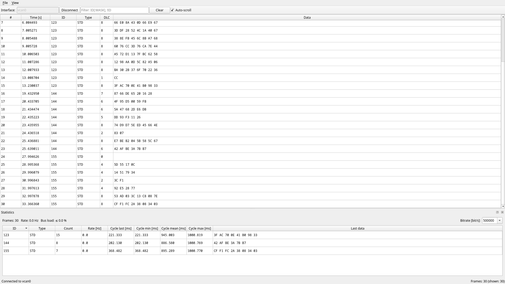

# CAN Log Visualizer

> 🚧 **Work in Progress**: This project is currently under development. 

A small CAN log visualizer, written in C++ using Qt 6 Widgets and CMake.

It reads CAN frames directly from Linux SocketCAN interfaces (including virtual `vcan` interfaces, so no hardware is needed) and shows them in a desktop UI.

## Documentation

- [Building and testing](docs/building.md)
- [Usage](docs/usage.md)
- [Coding conventions](docs/conventions.md)
